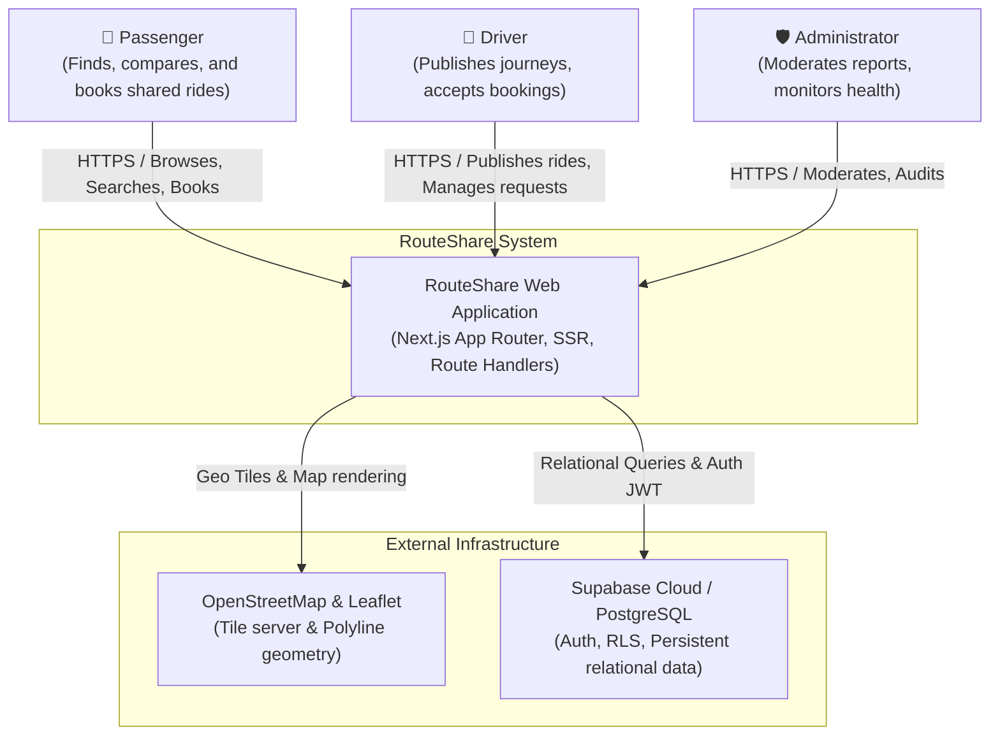
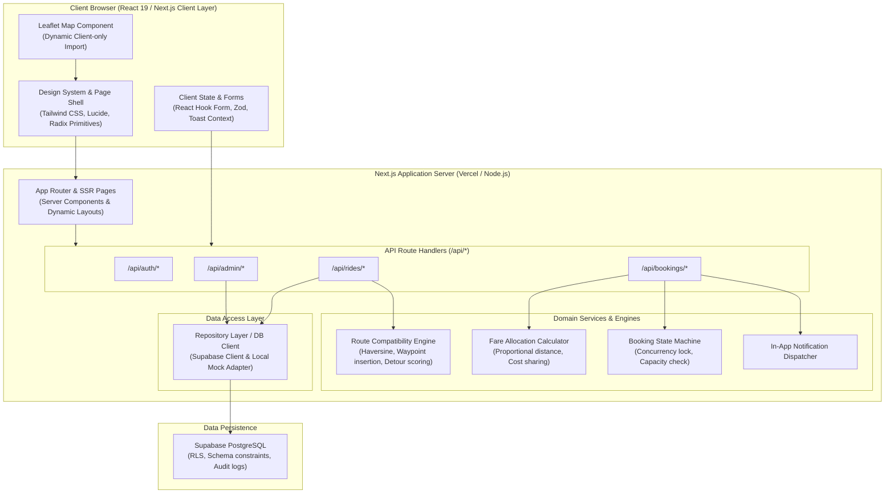
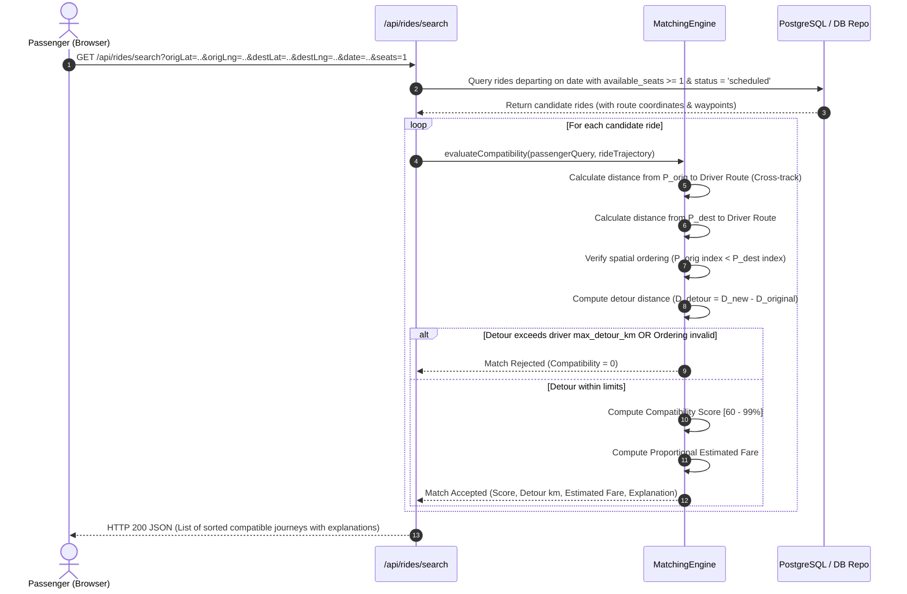
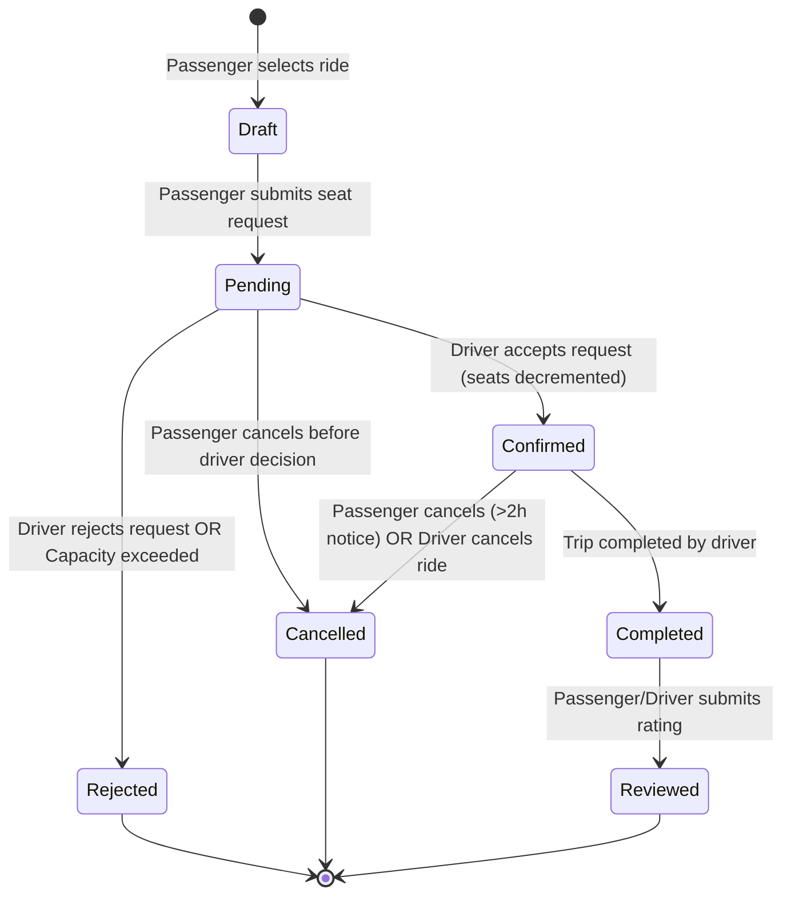
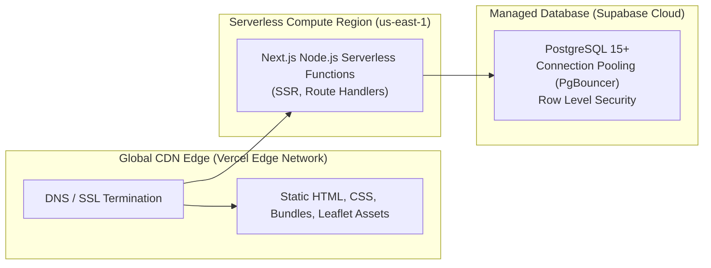

# High-Level System Design (HLD)
## RouteShare — Algorithmic Carpooling & Smart Ride-Sharing Platform

**Document Version:** 1.0.0  
**Architectural Style:** Modular Full-Stack Web Application (Next.js App Router + PostgreSQL)  

---

## 1. System Overview & Architectural Style

RouteShare is architected as a modular, unified full-stack system using the Next.js App Router paradigm backed by PostgreSQL (via Supabase).

### Why Modular Monolith over Microservices?
For a commuter ride-sharing platform at this scale:
1. **Transaction Integrity:** Booking a seat requires atomic verification against ride seat capacity. In a distributed microservice setup (e.g. separate Ride Service and Booking Service with distributed 2PC or Saga), latency and race conditions multiply. A unified schema with PostgreSQL row-level locks guarantees atomic seat reservation.
2. **Simplified Operational Footprint:** No Kubernetes cluster orchestration, Kafka broker maintenance, or RPC serialization overhead.
3. **Domain Isolation:** Boundaries are enforced logically inside the codebase via feature modules (`features/rides`, `features/matching`, `features/bookings`, `features/fare`, `features/notifications`, `features/admin`) and typed repository adapters.

---

## 2. System Context Diagram (C4 Level 1)

---

## 3. Container & Component Architecture (C4 Level 2)

---

## 4. Major Request & Response Flows

### 4.1 Ride Search and Algorithmic Matching Flow

### 4.2 Booking Lifecycle State Machine Flow

---

## 5. Security & Trust Boundaries

1. **Authentication Boundary:** Supabase Auth issues cryptographically signed JWT session cookies. The Next.js middleware and route handlers verify claims prior to executing business operations.
2. **Row Level Security (RLS) Enforcement:**
   - Even if client code is manipulated, PostgreSQL RLS policies prevent a user from reading private contact info of unconfirmed bookings, modifying another driver's ride, or forging admin privileges.
3. **Server-Side Fare & Capacity Enforcement:**
   - The browser never submits the price or seat availability count. The server recalculates passenger fare and checks remaining seats atomically inside a database transaction.
4. **Input Sanitization & Schema Validation:**
   - Every incoming payload passes through strict Zod schemas before touching any domain logic.

---

## 6. Deployment Architecture

---

## 7. Scalability & Architectural Trade-offs

| Architectural Decision | Chosen Alternative | Alternative Rejected | Justification |
| :--- | :--- | :--- | :--- |
| **Geospatial Matching** | In-Memory Haversine & Cross-Track Waypoint Insertion | PostGIS `ST_Distance` on every query | Next.js serverless functions can evaluate 50 candidate trajectories in $<10$ ms in memory without incurring heavy database CPU locks. PostGIS can be introduced seamlessly as data volume scales. |
| **Data Access Pattern** | Repository Pattern with Local Fixture Fallback | Hardcoded Direct Supabase Calls | Allows instant, flawless local zero-configuration demonstration for interviewers while fully supporting persistent Supabase credentials. |
| **Routing Provider** | Geometry Interpolation + Leaflet Polylines | Paid Google Maps / Mapbox Matrix API | Eliminates fragile API credit dependencies and unexpected billings while providing accurate, interactive route lines and reliable testing. |
