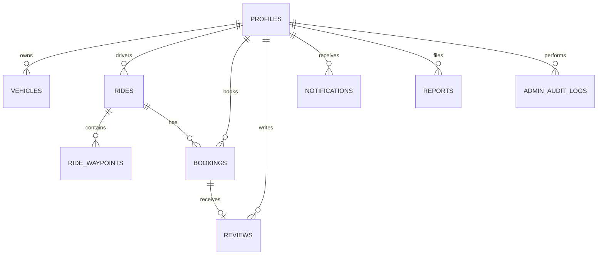

# Low-Level Design (LLD)
## RouteShare — Algorithmic Carpooling & Smart Ride-Sharing Platform

**Document Version:** 1.0.0  
**Target:** Implementation Specifications, Algorithmic Formulas & Database Schemas  

---

## 1. Core Domain Entities & Relationships



---

## 2. TypeScript Domain Models

```typescript
// Shared Coordinates & Location
export interface GeoCoordinate {
  latitude: number;
  longitude: number;
}

export interface LocationPoint extends GeoCoordinate {
  address: string;
  city: string;
  name?: string;
}

// User Profile
export interface Profile {
  id: string; // Supabase auth UUID
  email: string;
  fullName: string;
  phoneNumber?: string;
  avatarUrl?: string;
  bio?: string;
  role: 'user' | 'admin';
  ratingAverage: number;
  ratingCount: number;
  createdAt: string;
}

// Vehicle
export interface Vehicle {
  id: string;
  driverId: string;
  make: string;
  model: string;
  year: number;
  licensePlate: string;
  color: string;
  capacity: number; // e.g. 4
  isActive: boolean;
}

// Ride Waypoint
export interface RideWaypoint extends GeoCoordinate {
  id: string;
  rideId: string;
  address: string;
  orderIndex: number;
  stopType: 'pickup' | 'dropoff' | 'stopover';
  estimatedArrival?: string;
}

// Ride Entity
export type RideStatus = 'scheduled' | 'active' | 'completed' | 'cancelled';

export interface Ride {
  id: string;
  driverId: string;
  driver?: Profile;
  vehicleId: string;
  vehicle?: Vehicle;
  origin: LocationPoint;
  destination: LocationPoint;
  waypoints: RideWaypoint[];
  departureTime: string; // ISO 8601
  totalSeats: number;
  availableSeats: number;
  basePricePerKm: number; // e.g., 0.15 USD/km
  totalDistanceKm: number;
  estimatedDurationMinutes: number;
  maxDetourKm: number; // e.g. 15 km limit
  status: RideStatus;
  notes?: string;
  createdAt: string;
}

// Booking Entity
export type BookingStatus = 'pending' | 'confirmed' | 'rejected' | 'cancelled' | 'completed';

export interface Booking {
  id: string;
  rideId: string;
  ride?: Ride;
  passengerId: string;
  passenger?: Profile;
  seatsBooked: number;
  pickupLocation: LocationPoint;
  dropoffLocation: LocationPoint;
  segmentDistanceKm: number;
  detourDistanceKm: number;
  fareAmount: number;
  platformFee: number;
  totalPaid: number;
  status: BookingStatus;
  cancellationReason?: string;
  createdAt: string;
  updatedAt: string;
}

// Route Matching Result
export interface MatchResult {
  rideId: string;
  ride: Ride;
  compatibilityScore: number; // 0 to 100
  pickupDetourKm: number;
  dropoffDetourKm: number;
  totalDetourKm: number;
  detourTimeMinutes: number;
  passengerDistanceKm: number;
  estimatedFare: number;
  platformFee: number;
  isCompatible: boolean;
  explanation: string;
}
```

---

## 3. Mathematical Models & Core Algorithms

### 3.1 Haversine Distance Formula
Calculates the great-circle distance between two geographic coordinates $(\phi_1, \lambda_1)$ and $(\phi_2, \lambda_2)$ in kilometers:
$$a = \sin^2\left(\frac{\Delta \phi}{2}\right) + \cos(\phi_1)\cos(\phi_2)\sin^2\left(\frac{\Delta \lambda}{2}\right)$$
$$c = 2 \cdot \text{atan2}\left(\sqrt{a}, \sqrt{1 - a}\right)$$
$$d = R \cdot c \quad (\text{where Earth's radius } R = 6,371\text{ km})$$

### 3.2 Waypoint Insertion & Detour Calculation
Given a driver route with ordered waypoints $W = [D_{orig}, w_1, w_2, \dots, D_{dest}]$ and passenger points $(P_{orig}, P_{dest})$:
1. Identify the optimal insertion index $i$ for $P_{orig}$ and $j$ for $P_{dest}$ such that $0 \le i \le j \le |W|$.
2. Original driver distance:
   $$D_{orig} = \sum_{k=0}^{|W|-1} \text{dist}(W_k, W_{k+1})$$
3. New combined route distance:
   $$D_{new} = \text{dist}(W_0, \dots, P_{orig}, \dots, P_{dest}, \dots, W_{end})$$
4. Total detour introduced:
   $$\Delta d = D_{new} - D_{orig}$$
5. Compatibility Rule:
   $$\text{If } \Delta d > \text{MaxDetourKm or } i > j \implies \text{Score} = 0 \text{ (Incompatible)}$$
   $$\text{Otherwise: } \text{Score} = \max\left(50, \left(1 - \frac{\Delta d}{\text{MaxDetourKm}}\right) \times 100\right)$$

### 3.3 Proportional Fare Allocation Formula
To guarantee fairness, the passenger's fare is proportional to their travel segment length, discounted for shared occupancy, plus a transparent 5% platform contribution:
$$\text{Passenger Base Fare} = (\text{Passenger Segment Distance Km} \times \text{Base Price Per Km})$$
$$\text{Shared Discount} = \min(0.25, 0.05 \times \text{Total Confirmed Passengers})$$
$$\text{Fare Subtotal} = \text{Passenger Base Fare} \times (1 - \text{Shared Discount})$$
$$\text{Platform Maintenance Contribution (5\%)} = \text{round}(\text{Fare Subtotal} \times 0.05, 2)$$
$$\text{Total Passenger Charge} = \text{Fare Subtotal} + \text{Platform Fee}$$

---

## 4. Database Schema & Migration Specification

```sql
-- Enable UUID extension
CREATE EXTENSION IF NOT EXISTS "uuid-ossp";

-- 1. Profiles Table
CREATE TABLE public.profiles (
    id UUID PRIMARY KEY REFERENCES auth.users(id) ON DELETE CASCADE,
    email TEXT NOT NULL UNIQUE,
    full_name TEXT NOT NULL,
    phone_number TEXT,
    avatar_url TEXT,
    bio TEXT,
    role TEXT NOT NULL DEFAULT 'user' CHECK (role IN ('user', 'admin')),
    rating_avg NUMERIC(3, 2) NOT NULL DEFAULT 5.00,
    rating_count INT NOT NULL DEFAULT 0,
    is_suspended BOOLEAN NOT NULL DEFAULT FALSE,
    created_at TIMESTAMPTZ NOT NULL DEFAULT NOW(),
    updated_at TIMESTAMPTZ NOT NULL DEFAULT NOW()
);

-- 2. Vehicles Table
CREATE TABLE public.vehicles (
    id UUID PRIMARY KEY DEFAULT uuid_generate_v4(),
    driver_id UUID NOT NULL REFERENCES public.profiles(id) ON DELETE CASCADE,
    make TEXT NOT NULL,
    model TEXT NOT NULL,
    year INT NOT NULL,
    license_plate TEXT NOT NULL UNIQUE,
    color TEXT NOT NULL,
    capacity INT NOT NULL CHECK (capacity BETWEEN 1 AND 8),
    is_active BOOLEAN NOT NULL DEFAULT TRUE,
    created_at TIMESTAMPTZ NOT NULL DEFAULT NOW()
);

-- 3. Rides Table
CREATE TABLE public.rides (
    id UUID PRIMARY KEY DEFAULT uuid_generate_v4(),
    driver_id UUID NOT NULL REFERENCES public.profiles(id) ON DELETE CASCADE,
    vehicle_id UUID NOT NULL REFERENCES public.vehicles(id) ON DELETE RESTRICT,
    origin_address TEXT NOT NULL,
    origin_city TEXT NOT NULL,
    origin_lat NUMERIC(9, 6) NOT NULL,
    origin_lng NUMERIC(9, 6) NOT NULL,
    dest_address TEXT NOT NULL,
    dest_city TEXT NOT NULL,
    dest_lat NUMERIC(9, 6) NOT NULL,
    dest_lng NUMERIC(9, 6) NOT NULL,
    departure_time TIMESTAMPTZ NOT NULL,
    total_seats INT NOT NULL CHECK (total_seats BETWEEN 1 AND 8),
    available_seats INT NOT NULL CHECK (available_seats >= 0),
    base_price_per_km NUMERIC(6, 2) NOT NULL CHECK (base_price_per_km > 0),
    total_distance_km NUMERIC(8, 2) NOT NULL,
    estimated_duration_min INT NOT NULL,
    max_detour_km NUMERIC(5, 2) NOT NULL DEFAULT 15.0,
    status TEXT NOT NULL DEFAULT 'scheduled' CHECK (status IN ('scheduled', 'active', 'completed', 'cancelled')),
    notes TEXT,
    created_at TIMESTAMPTZ NOT NULL DEFAULT NOW(),
    updated_at TIMESTAMPTZ NOT NULL DEFAULT NOW()
);

-- 4. Ride Waypoints Table
CREATE TABLE public.ride_waypoints (
    id UUID PRIMARY KEY DEFAULT uuid_generate_v4(),
    ride_id UUID NOT NULL REFERENCES public.rides(id) ON DELETE CASCADE,
    address TEXT NOT NULL,
    lat NUMERIC(9, 6) NOT NULL,
    lng NUMERIC(9, 6) NOT NULL,
    order_index INT NOT NULL,
    stop_type TEXT NOT NULL DEFAULT 'stopover' CHECK (stop_type IN ('pickup', 'dropoff', 'stopover')),
    created_at TIMESTAMPTZ NOT NULL DEFAULT NOW()
);

-- 5. Bookings Table (with concurrency and check constraints)
CREATE TABLE public.bookings (
    id UUID PRIMARY KEY DEFAULT uuid_generate_v4(),
    ride_id UUID NOT NULL REFERENCES public.rides(id) ON DELETE CASCADE,
    passenger_id UUID NOT NULL REFERENCES public.profiles(id) ON DELETE CASCADE,
    seats_booked INT NOT NULL CHECK (seats_booked > 0),
    pickup_address TEXT NOT NULL,
    pickup_lat NUMERIC(9, 6) NOT NULL,
    pickup_lng NUMERIC(9, 6) NOT NULL,
    dropoff_address TEXT NOT NULL,
    dropoff_lat NUMERIC(9, 6) NOT NULL,
    dropoff_lng NUMERIC(9, 6) NOT NULL,
    segment_distance_km NUMERIC(8, 2) NOT NULL,
    detour_distance_km NUMERIC(6, 2) NOT NULL DEFAULT 0.0,
    fare_amount NUMERIC(8, 2) NOT NULL,
    platform_fee NUMERIC(8, 2) NOT NULL,
    total_paid NUMERIC(8, 2) NOT NULL,
    status TEXT NOT NULL DEFAULT 'pending' CHECK (status IN ('pending', 'confirmed', 'rejected', 'cancelled', 'completed')),
    cancellation_reason TEXT,
    created_at TIMESTAMPTZ NOT NULL DEFAULT NOW(),
    updated_at TIMESTAMPTZ NOT NULL DEFAULT NOW()
);

-- 6. Indexes for Performance
CREATE INDEX idx_rides_departure ON public.rides(departure_time);
CREATE INDEX idx_rides_status ON public.rides(status);
CREATE INDEX idx_rides_driver ON public.rides(driver_id);
CREATE INDEX idx_bookings_ride ON public.bookings(ride_id);
CREATE INDEX idx_bookings_passenger ON public.bookings(passenger_id);
CREATE INDEX idx_bookings_status ON public.bookings(status);
```

---

## 5. Concurrency & Transactional Seat Allocation

To prevent double-booking when two passengers request the final seat simultaneously, the state transition executes inside an atomic PostgreSQL function or serialized transaction:

```sql
CREATE OR REPLACE FUNCTION confirm_booking(p_booking_id UUID, p_driver_id UUID)
RETURNS JSON AS $$
DECLARE
    v_ride_id UUID;
    v_seats INT;
    v_avail INT;
BEGIN
    -- 1. Verify caller is the ride's driver
    SELECT b.ride_id, b.seats_booked, r.available_seats
    INTO v_ride_id, v_seats, v_avail
    FROM public.bookings b
    JOIN public.rides r ON b.ride_id = r.id
    WHERE b.id = p_booking_id AND r.driver_id = p_driver_id
    FOR UPDATE OF r; -- Row-level lock on ride

    IF NOT FOUND THEN
        RETURN json_build_object('success', false, 'error', 'Unauthorized or booking not found');
    END IF;

    -- 2. Verify remaining seats
    IF v_avail < v_seats THEN
        RETURN json_build_object('success', false, 'error', 'Insufficient available seats remaining');
    END IF;

    -- 3. Atomic transition
    UPDATE public.rides 
    SET available_seats = available_seats - v_seats, updated_at = NOW()
    WHERE id = v_ride_id;

    UPDATE public.bookings
    SET status = 'confirmed', updated_at = NOW()
    WHERE id = p_booking_id;

    RETURN json_build_object('success', true);
END;
$$ LANGUAGE plpgsql SECURITY DEFINER;
```

---

## 6. Error Handling & Standard API Responses

All API Route Handlers adhere to standard RFC 7807 JSON schemas:

```typescript
export interface ApiResponse<T = unknown> {
  success: boolean;
  data?: T;
  error?: {
    code: 'BAD_REQUEST' | 'UNAUTHORIZED' | 'FORBIDDEN' | 'NOT_FOUND' | 'SEAT_CONFLICT' | 'INTERNAL_ERROR';
    message: string;
    details?: unknown;
  };
}
```
